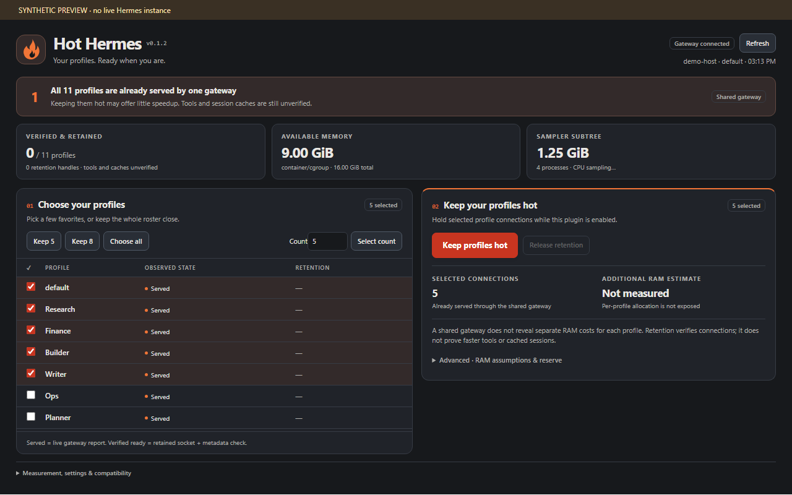

# Hot Hermes 0.1.2 — experimental test package


**Know what is already hot. Keep selected connections ready.**

A compact flame-and-ember dashboard: monitor profile service status, compare five/eight/custom/all selections, and explicitly retain chosen Desktop connections. No model calls, dummy chat messages, core patches, telemetry or downloads.



## What is implemented

- A native Desktop page with the current source's profile inventory, served/verified-ready/unknown states, selected-profile retention and release controls.
- Sequential warm-up through the public `host.retainProfile` API; metadata-only verification through `host.requestProfile(..., "profiles.list")`.
- Timeout, cancellation and disconnect cleanup. Plugin disable and source changes release its handles. No automatic warming on install or page open. No automatic retry after failure.
- Read-only host-memory and backend process-tree sampling via the authenticated Hermes plugin backend. Linux estimates account for cgroup v1/v2 memory pressure. Windows uses psutil. CPU needs two samples. Missing psutil yields unavailable metrics without installing anything.
- Five/eight/custom/all selection and additional RAM planning using an explicitly entered measured/assumed range. After explicit warming, compares host memory before/after and offers that observed average as a planning input. The sample is noisy and is not isolated per-profile attribution. No invented per-profile memory or idle CPU allocation.

## Material limitations / unfinished integration

**No configurable Desktop backend-pool limit was found on the tested v0.23.1 build.** The earlier reported setting of five is unconfirmed. The page does not invent a value or change a competing setting. Other versions require their own verification.

**CT114 already serves all 11 profiles through one shared gateway.** The dashboard detects this topology and explains that retaining extra connections may offer little or no switching-speed benefit. Tools and session history remain separate concerns.

**A retention handle keeps a Desktop connection, not every agent/session/tool in RAM.** A successful check establishes a responding backend only. Tools, transcript caches and provider prompt-cache residency are unverified. Retention is scoped to this Desktop process; closing it does not create an always-on server policy. Existing host limits still apply.

**Resource estimates need calibration.** Shared gateways do not expose per-profile attribution. RAM planning uses the operator's explicit range and measured available memory. CPU shown is current backend activity, not a prediction for additional profiles. Full automatic sizing, per-profile telemetry, budget-triggered release and measured speed improvements remain future work.

The 0.1.0 package passed installation/staging checks on CT114 and Windows Desktop; measured memory matched server observations. This 0.1.1 redesign needs its own live acceptance check. No switching-speed improvement has been measured.

## Install

From the public repository:

```sh
hermes plugins install firetussin/hermes-hot-hermes --enable
```

For a remote gateway, install the backend there and use Desktop's Install from Git to install the Desktop component on your own computer. Until the catalog PR is merged, install by the repository path above rather than the short catalog name.


See INSTALL.md. With a remote backend there are **two pieces**: the backend on the Hermes server, and the Desktop page on the computer running Hermes Desktop. Installing only on Host8 does not necessarily install the page locally.

Requires Hermes 0.23+ for the tested source surface, with feature detection for the newer Desktop profile APIs. The manifest floor is not a claim that every 0.23 distribution exposes retention. Unsupported builds show unavailable routes or fail the explicit request without patching core.

## Use

1. Enable the backend and Desktop component, then open Hot Hermes in the sidebar.
2. Read current served/unknown states and host metrics. No cold profiles are started by this read.
3. Choose five, eight, all, or a custom set. The names checked in the table are authoritative; count buttons select the first N inventory entries rather than silently guessing favorite profiles.
4. Enter a RAM range if known. Empty inputs preserve “Insufficient data.” Review headroom and the explicit start request.
5. Start keep-ready to acquire sequential retention handles. Inspect each profile's result. Release Hot Hermes retention to stop holding handles without stopping active chats.

Policies are deliberately not auto-restored after restart. No keep-ready selection is persisted in v0.1.0. Switching profiles on the same connection retains handles; switching connections releases them. The page resets its proposed selection on a profile switch, so reselect before changing the policy.

## Privacy and overhead

Backend reads OS memory/CPU and process-tree metadata only. It does not open profile credentials, configs, conversations or session databases. Requests use Hermes authentication. Responses include aggregate memory/CPU, count, current PID and an opaque hashed machine marker. No process command lines, raw hostnames or tokens are returned.

Desktop reads the public current-source inventory/status and credential-free route descriptors. Only an explicitly selected keep-ready policy sends per-profile metadata requests. Every 15 seconds the plugin refreshes the current source and verifies its own held connections. It creates no independent server or background job. Failed verification releases that handle. Page unmount does not release a chosen policy; disabling the plugin does.

## Development / validation

```text
python tools/build.py
node --test tests/logic.test.mjs
python -m unittest discover -s tests -p "test_*.py" -v
```

Browser checks use an offline synthetic SDK fixture; see VALIDATION.md. Browser screenshots are illustrative, not Host8 telemetry. Generated desktop/plugin.js is self-contained and imports only React and the Hermes SDK.

Source reference inspected: local Hermes tree HEAD `3b421578588243f920886e6fe79a6faa87ea026e` (read-only source inspection; worktree cleanliness not established). Target-host compatibility must still be checked.

## Host8 feedback addressed in 0.1.1

Compact adjacent selection/planning, a prominent red-orange **Keep profiles hot** action, flame branding, and expandable advanced details. The dashboard counts all served profiles once and identifies shared-gateway topology. Process counts/RSS cover the sampler subtree only, with enumeration/truncation coverage, not the total Hermes footprint. Memory without an exposed cgroup limit is labelled the host/container view visible to the process, which accommodates lxcfs-backed LXC memory.

Hermes enabling the declared tool added `hot_hermes` to four platform toolset lists in the CT114 test. This is host-managed enable behavior; the plugin installer does not write config.yaml. Record those changes for rollback.

[Changelog](CHANGELOG.md) · [Installation and rollback](INSTALL.md) · [Validation](VALIDATION.md)


## Replacement fix in 0.1.2

Backups and temporary staging now go under `<Hermes home>/plugin-backups/`, outside `plugins/` and `desktop-plugins/`. Older installers placed backups inside discovery roots, which could shadow the active version. Existing backup directories from 0.1.0/0.1.1 must be moved outside those roots by the operator; this installer does not silently remove them.

Host8 live feedback: holding three and then all eleven connections worked; no new per-profile server backends appeared and no latency improvement was measured. CPU attribution is unresolved. Selected connections are metadata-checked every 15 seconds (up to four checks per selected connection per minute), in addition to source refreshes. This is not free idle work; Release is needed for a controlled CPU comparison.
